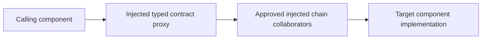

# Mandatory component proxies

**Authority:** human-owner decision on 2026-11-07, including clarification that the requirement applies between components only. **Pattern:** PAT-001. **Classification:** implementation constraint under The Method, not a new statement attributed to Löwy. Original source references remain unchanged.

## Standard Technical English requirements

| ID | Condition | Required action |
| --- | --- | --- |
| PROXY-01 | A call crosses an approved component boundary | Route the call through a proxy implementing the reviewed component contract. Do not bypass the proxy because components share a process. |
| PROXY-02 | Constructing the call chain | Support dependency injection for the proxy and its required collaborators. Keep registration and lifetime selection in the composition root. |
| PROXY-03 | No service-level separation exists | Generate the typed proxy at build time. Use explicit typed forwarding to the approved implementation behind the boundary. |
| PROXY-04 | Selecting a proxy implementation | Do not implement reflection-based proxy generation or dispatch. Do not use DispatchProxy, reflection emit, MethodInfo.Invoke, or equivalent runtime proxy machinery as a substitute for the required typed proxy. |
| PROXY-05 | A service boundary exists | Use the approved service proxy or invocation boundary with DI-capable application-side wiring. A Dapr sidecar service-invocation route is an accepted realization. |
| PROXY-06 | Registering a component dependency | Resolve the caller-facing contract to the approved proxy chain. Do not expose a direct target registration to callers that bypasses that chain. |
| PROXY-07 | Designing a proxy chain | Preserve allowed Method interactions, reviewed contract semantics, dependency lifetimes, cancellation, and failure behavior. A proxy does not authorize an otherwise prohibited call. |
| PROXY-08 | A call remains inside one component | Do not require a proxy solely because of this policy. Internal collaborator design remains within the reviewed component design. |
| PROXY-09 | Changing proxy policy or generated inputs | Escalate to the responsible architect. Workers cannot remove the proxy, weaken its checks, or amend upstream contracts to simplify implementation. |

The reflection prohibition concerns the proxy implementation and invocation mechanism. It does not silently prohibit all reflection elsewhere in an application or all DI-container internals. Serialization and unrelated reflection use require their own approved technical decisions. Runtime-generated mocking proxies are not a compliant implementation of this production boundary; test substitutes can be explicit or generated typed implementations.

## Call-chain shapes

This local form is generated when the boundary has no service-level separation. The final proxy-to-target dispatch is an authorized part of the boundary, not permission for the original caller to access the concrete target. No additional process, network hop, or Dapr deployment is required for this local form.

For an approved Dapr realization, the route is caller → injected contract proxy or adapter → local sidecar → destination sidecar → target endpoint. Dapr provides the service-invocation boundary; application-side DI wiring and typed contracts still require design. Dapr is accepted, not mandated or deployed. See [Dapr invocation](https://docs.dapr.io/developing-applications/building-blocks/service-invocation/service-invocation-overview/) and its [.NET client DI examples](https://docs.dapr.io/developing-applications/sdks/dotnet/dotnet-client/), checked 2026-11-07.

## Detailed design and ownership

The Solution Architect defines component boundaries, allowed edges, and permitted transport realizations. The Application Architect specifies the contract, proxy chain, injected extension points, registration, lifetimes, and local or remote dispatch. The Test Architect defines required verification. The Project Manager includes generation, implementation, review, and integration work in the plan.

Identify the calling component, target component, contract revision, generated-proxy revision, chain collaborators and order, lifetime rules, and any service endpoint in the handoff. Inject collaborators through explicit contracts. Do not use ad hoc service location in business code. Validate registration and scope compatibility. These wiring practices follow current [Microsoft DI guidance](https://learn.microsoft.com/en-us/dotnet/core/extensions/dependency-injection/guidelines), checked 2026-11-07, within the owner's boundary requirement.

## Roslyn implementation and enforcement plan

- Generate local typed proxies and explicit registration extensions from the approved contracts and boundary records. Fail generation for missing or incompatible approved inputs.
- Analyze semantic symbols and operations for direct cross-component construction, implementation references, calls, and direct contract-to-target wiring outside approved composition and dispatch locations. Do not rely on class suffixes alone.
- Diagnose reflection-based proxy dispatch and known runtime proxy factories within the scoped proxy implementation. Include generated code and approved library boundaries in the verification strategy; a third-party binary is not proven compliant by scanning caller syntax.
- Validate that contract injection resolves to the expected proxy chain. Static analysis can validate explicit registrations; runtime composition tests verify effective resolution and lifetimes.
- Protect the component map, contracts, generator, analyzer, registrations, and rule configuration against worker amendment. The independent gate must validate the submitted revision against those approved inputs.

Roslyn cannot prove every dynamic or remote call path from syntax alone. Reflection, dynamic invocation, direct HTTP clients, externally loaded code, and altered runtime configuration can defeat a purely static model. Combine semantic checks with approved dependency restrictions, composition tests, runtime boundary tests, and independent integration. These projects and permissions are not implemented by this document.

## Required verification

1. A valid component dependency resolves through the expected proxy and injected chain in order.
2. A direct caller-to-target bypass is rejected, including an interface registration that resolves directly to the target.
3. A local component boundary without service separation receives a generated typed proxy.
4. A reflection-based proxy implementation is rejected.
5. A generated local proxy preserves contract results, failures, cancellation, and scope behavior.
6. A selected Dapr route is exercised through the actual sidecars and target endpoint, including failure behavior. Presence of a sidecar alone is insufficient evidence.
7. An internal collaborator call is not incorrectly diagnosed as a component-boundary violation.
8. Test substitution replaces the approved endpoint or collaborator without creating an unapproved production bypass.

See [technical standards](../standards/microsoft-technical-standard.md) and [enforcement boundaries](../implementation/enforcement-boundaries.md). No application runtime, Dapr version, or transport baseline is selected here.

## Implementation location

The owner assigned reusable implementation mechanisms and their detailed tooling design to vc.Ifx. Keep required behavior, Method constraints, and adoption status here. See [repository ownership and handoff](../implementation/repository-ownership.md). The location decision is resolved; remaining mechanism decisions belong in the vc.Ifx design effort.
