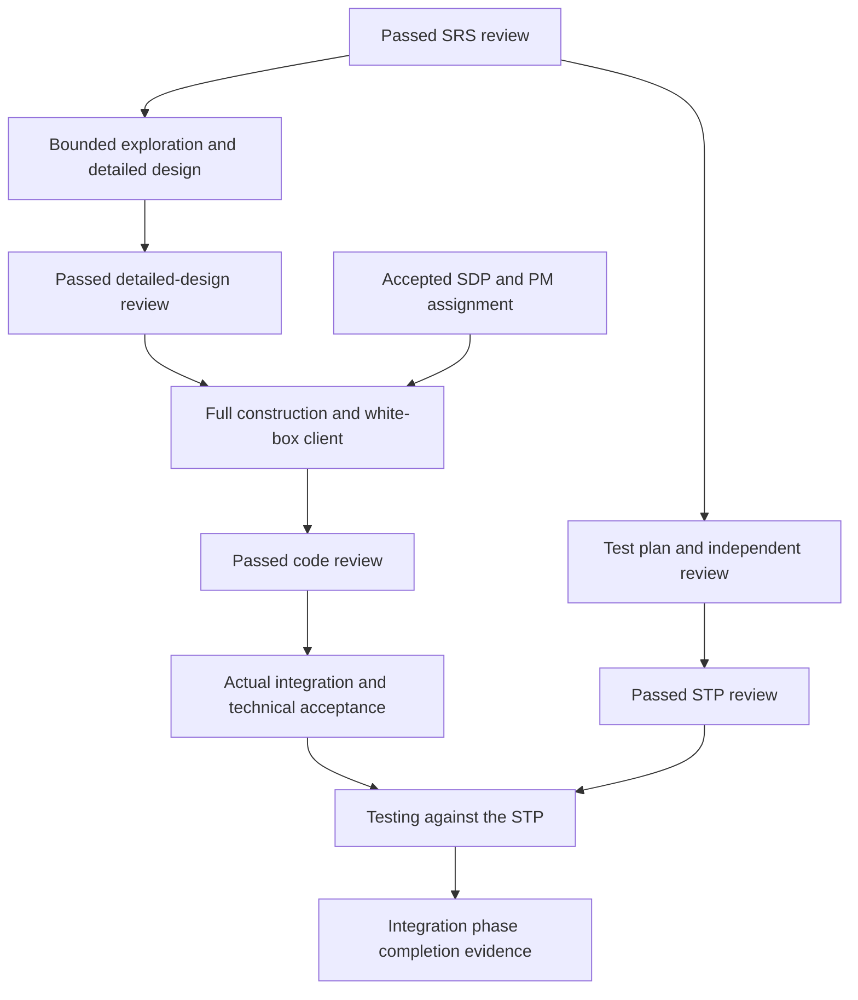

# Lifecycle gate criteria

Version 1.0.0, reviewed 2026-11-08. Governing sources: [Righting Software](https://www.amazon.com/dp/0136524036), pp. 153, 194, 376–377, 380–381, 388–391, and 405; the owner's [approval matrix](../governance/decision-and-approval-matrix.md) supplies role assignments. The [gate catalog](lifecycle-gates.json) is the machine-readable specification. Predicate names and record mechanics are governance choices, not wording attributed to Löwy.

## Gate meaning

A gate evaluates one requested action for a specific repository, activity, component, artifact revision, adopted baseline, and relevant environment. **Pass** means its applicable criteria have verified evidence. **Fail** means a known criterion failed. **Blocked** means required evidence is missing, unverified, or awaiting a decision. An earlier pass needing impact reassessment is not a current pass. Only pass permits the listed next action, and that action must also have its current PM assignment and any other applicable gates.

Every gate checks exact reference integrity, decision authority, independent review where required, upstream bounds, and current applicability. A record containing a role or a passed flag is not evidence that these checks actually occurred. Evaluate applicable freshness, revocation, withdrawal, and change effects under the [validity policy](../governance/change-approval-validity.md).

Gate results do not create new roles or approval channels. Use existing review, decision, assignment, verification, integration, and phase-exit records. A decision accepting one action cannot stand in for another owner's required decision. One authentic record can establish multiple predicates if it supplies the required evidence for each predicate in the same context. Do not add duplicate reviews only to increase the record count.

## Gate criteria

| Gate | Required inputs and successful evidence | Permitted action / unsuccessful result |
| --- | --- | --- |
| GATE-BASELINE | Reviewed business inputs, system requirements, architecture and technology bounds, valid delegations, and CEO approval of SA-owned decisions | Design the project within those bounds. Resolve missing or disputed inputs with their owners. |
| GATE-SDP | System design; designed project options, activities/network, resource/calendar and cost basis, risk and quality work; management acceptance of a feasible selected option within human-owner bounds | PM may assign main construction. An unsigned, unaffordable, or unaccepted option does not authorize main work. |
| GATE-SRS | Exact service requirement spec, successful architect review and acceptance, resolved behavioral ambiguity | Test planning and bounded exploration/detailed design may proceed on parallel paths under their assignments. Failed review returns to the SRS. |
| GATE-EXPLORE | Reviewed SRS and PM assignment identifying questions, allowed experiments, constraints, and designer feedback | Perform some construction for design insight. Return findings to the Application Architect; do not claim production readiness or waive detailed-design review. |
| GATE-DESIGN | Detailed design and contracts within the system design; successful Solution Architect review; Test Architect input; discovered refinements resolved | Detailed Design phase can complete. Prepare handoff; full construction still requires SDP and PM authorization. Failure returns to detailed design. |
| GATE-CONSTRUCT | Accepted SDP, reviewed SRS and detailed design, applicable bounds and allowed dependencies, resolved refinements, current PM assignment and complete handoff | Construct the service with its white-box test client. Hold affected construction if required inputs are invalid. STP review is not a prerequisite. |
| GATE-STP | Exact service test plan, Application Architect and independent test critique, Test Architect approval | Test Plan phase can complete. Execution awaits the integrated implementation. Failure returns to test planning. |
| GATE-CODE | Exact assigned implementation and white-box client, current design, successful Application Architect and independent Test Agent review, leading-architect acceptance | Construction phase can complete; authorized integration may proceed. A commit alone is not completion. Failure returns to construction. |
| GATE-INTEGRATE | Reviewed source revisions, actual required dependency integration, recorded integrated snapshot/environment, technical integration acceptance by Solution Architect | Plan-based testing may proceed once STP review also passes. Integration acceptance alone does not complete the Integration phase. |
| GATE-VERIFY | Approved STP, exact integrated snapshot and environment, successful required cases and applicable regression/real-service evidence, Test Architect acceptance | Supply verification evidence for Integration phase completion. Correct failures and reassess affected inputs; do not relax the plan to match defects. |
| GATE-PHASE | Successful evidence for this particular phase and the consistently selected weight basis | PM records binary completion and corresponding credit. Incomplete or unsupported phases receive no credit. |
| GATE-MILESTONE | The selected milestone's required system/subsystem/component/interaction, regression and smoke checks, real-dependency evidence, and Product Owner acceptance | Record the agreed milestone. This is not permission to deploy or operate a live capability. |
| GATE-RESUME | Change impact assessment, all affected domain decisions, required revalidation/reaffirmation, and PM release of the affected assignment | Resume only the assessed scope under accepted revisions. Unaffected authorized work may continue while affected work remains held. |

The table summarizes criteria; the catalog contains explicit predicates, decision routes, return behavior, and source pages. Gate applicability follows the project design. Front-end baseline readiness does not require all detailed designs or exhaustive final requirements. Noncoding activities use their own project-designed internal tasks and binary exit criteria; a calendar activity, training task, or infrastructure task is not forced through every service gate.

## Preserve the parallel paths

An STP review may succeed before detailed design is complete. If later design details change the plan's assumptions or coverage, reassess and revise the plan through its owner before testing. A failed STP review alone does not impose a construction gate; a finding that actually invalidates shared requirements or design can hold affected construction through the change policy. These are different conditions.

## Phase exits

| Phase | Binary criterion |
| --- | --- |
| Requirements | GATE-SRS passes for the applicable SRS revision |
| Detailed Design | GATE-DESIGN passes for the applicable design revision |
| Test Plan | GATE-STP passes for the applicable STP revision |
| Construction | GATE-CODE passes for the applicable submitted source revision |
| Integration | Both technical integration acceptance and successful plan-based testing cover the same integrated context: GATE-INTEGRATE and GATE-VERIFY |

GATE-PHASE records the applicable criterion; it is not an extra technical approval. Preserve consistent phase weighting rather than adopting the book's example percentages. Exploration, partial coding, review attempts, and consumed tokens do not complete a phase. Phase results are scoped to an activity and baseline, not universal claims that no later rework will occur.

## Feedback, early work, and escalation

A failed review returns the preceding internal task (p. 389). If correction changes another owner's input, route the change before implementing under it. A code defect can return work to construction; a contract defect goes through the Application Architect and required architectural review; a business ambiguity goes to the Product Owner. Recompute affected gate eligibility when new source, design, environment, or plan revisions appear.

Löwy discusses bounded early infrastructure/Client design on p. 279. It is an architect-designed project option with explicit proceed/cancel risk, not a worker bypass of the SDP. If selected, record its authority, limits, cost treatment, and dependencies separately. Normal component main construction remains behind GATE-SDP. A front-end research assignment is not proof that service construction or design has completed.

Cross-domain disputes follow the established three-round procedure. Failed reviews and test retries do not consume those rounds. Unresolved source conflicts go to the human owner; no gate, CEO decision, or urgency can waive a Method directive. No lifecycle gate independently authorizes deployment, live operation, or changes outside human-owner bounds.

## Verification scope

The [acceptance fixtures](../artifacts/lifecycle-validity-cases.json) specify abstract positive and negative gate cases for future implementations. The [validation report](../artifacts/lifecycle-validity-validation.json) distinguishes policy/fixture checks from operational identity, byte verification, and permission enforcement. The reusable framework does not deploy a gate service here.
