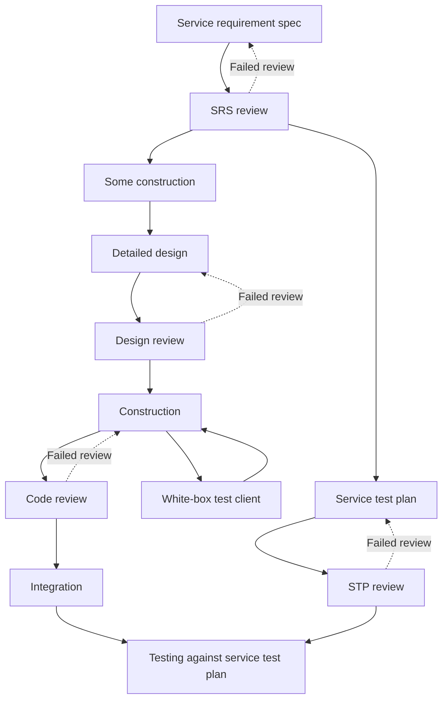

# Service lifecycle

## Source and scope

The owner selected the workflow in [Righting Software](https://www.amazon.com/dp/0136524036), Figure A-2, printed p. 390. Figure A-1 on p. 388 and its explanation on p. 389 establish task order, concurrent paths, and review retries. This is the activity lifecycle inside the broader [system and project design](system-and-project-design.md) process. It does not replace those design efforts or the Software Development Plan review.

In these figures, **SRS means service requirement spec** and **STP means service test plan**. System requirements specifications and system test plans are separate system-level artifacts; use explicit names in handoffs to avoid confusing them.

The diagram below preserves the source's forward paths. Review failure returns to the preceding task; the source explanation explicitly states that retries were omitted from the printed drawing for clarity.

The test-plan and detailed-design paths can progress concurrently after SRS review. The figure makes the reviewed STP a prerequisite to testing. It does not draw an STP-review dependency into detailed design or construction. Do not silently serialize those paths.

## Activity phases

| Phase | Internal tasks in the selected lifecycle | Binary completion basis |
| --- | --- | --- |
| Requirements | Service requirements and SRS review | Successful SRS review |
| Detailed Design | Some construction, detailed design, and design review | Successful design review |
| Test Plan | Service test plan and STP review | Successful STP review |
| Construction | Service construction, white-box test client, and code review | Successful code review |
| Integration | Integration and testing against the reviewed plan | Successful required testing after integration |

RS p. 389 requires successful reviews and binary phase exits. Checking in code does not complete Construction. Failed reviews return work for correction; elapsed effort does not earn partial completion of an unfinished phase.

RS pp. 390-393 permits consistent weighting methods. The example 15/20/10/40/15 percentages are illustrative, not an imposed allocation. The Project Manager tracks earned progress and effort separately and reports progress through integration points under C-PT-1 through C-PT-6.

## Applying the delegated detailed-design arrangement

Chapter 14, pp. 376-377 explains the arrangement corresponding to the owner's Application Architect role: a senior designer creates component details, the architect reviews them before handoff, construction workers consult the designer about refinements, and the senior designer reviews the code. Explicit detailed-design activities and additional integration points must appear in project design when design work is extracted from the service activity.

The owner requires the following handoff behavior:

1. The Solution Architect establishes the component boundaries and system design.
2. The Application Architect creates the detailed component design, including contracts, within those boundaries. The Solution Architect reviews the design before handoff.
3. The Project Manager assigns the component work with its detailed design and related feature requirements. Requirements describe the behavior the component contributes to through integration. They do not authorize feature-based decomposition.
4. The developer performs enough exploratory construction to understand and demonstrate its approach. If it discovers a need to refine the supplied design, it consults the Application Architect before full construction proceeds on that refinement.
5. The Application Architect evaluates the refinement. A change outside its authority goes to the Solution Architect or another responsible owner. Approved detailed-design revisions receive the required design review before construction proceeds under them.
6. The developer constructs within the approved design and builds the white-box test client in tandem. The test client exercises parameters, conditions, and error paths during development; independent test development does not remove this developer responsibility.
7. Code review includes the Application Architect and a Test Agent as critics. Successful review precedes integration. Integration precedes black-box unit testing against the reviewed service test plan.

This preserves the source's exploratory-construction and review paths while assigning the detailed-design authority to the owner's Application Architect. It does not introduce an independent developer-owned design baseline.

## Test responsibilities

The Test Architect defines how the system design and detailed designs will be tested. Test Developers implement those requirements, including harnesses and automation. Test Agents execute verification and critique implementation. The owner selected Test Architect approval of the service test plan after Application Architect and independent Test Agent review. The source does not name the owner's Test Architect role; this is the organizational mapping in the [decision matrix](../governance/decision-and-approval-matrix.md).

RS pp. 380-381 requires explicit system test planning, system test harness development, system testing, test automation, and regression-design activities. Service-level test plans and white-box test clients do not replace these activities. Daily clean builds and smoke tests are also part of the source's quality-control practices.

Black-box unit testing in Appendix A describes that service-level lifecycle step. It does not mean the project may stop at unit testing. Chapter 2, pp. 25-26 requires regression coverage of the system, subsystems, components, and their interactions. If compression uses simulators, repeat integration and testing with the real services (pp. 212 and 284-285).

## Feedback and change

A rejected SRS, STP, detailed design, or implementation returns to its preceding task. Corrections that would change another owner's approved input are routed to that owner; they cannot be disguised as local rework. The owner requires escalation for changes to both system and detailed designs.

When scope changes affect schedule, cost, dependencies, or resources, the Solution Architect and Project Manager close the loop on project design. RS p. 194 and Appendix A, p. 405 requires assessing the consequences and presenting revised commitments for a decision. A local design approval does not, by itself, approve altered project commitments.

## Handoff content to specify

The required detailed design and related requirements are owner decisions. The operational handoff should also identify the component, assigned worker, responsible architects, source versions, relevant constraints, dependencies, current lifecycle phase, and required review evidence. These record fields are an enforcement proposal, not additional Appendix C design rules. The [work assignment contract](../templates/artifacts/work-assignment.md), [artifact contract](../artifacts/README.md), and [decision matrix](../governance/decision-and-approval-matrix.md) now define those fields and logical sign-offs. Runtime storage, identity authentication, and permission enforcement remain separate implementation decisions.

## Operational gate criteria

The [gate specification](lifecycle-gates.md) and [machine-readable catalog](lifecycle-gates.json) define required inputs, successful evidence, permitted actions, and correction routes. The [approval-validity policy](../governance/change-approval-validity.md) determines whether prior evidence is applicable to the requested action. STP review remains a prerequisite for plan-based testing, not full construction.
